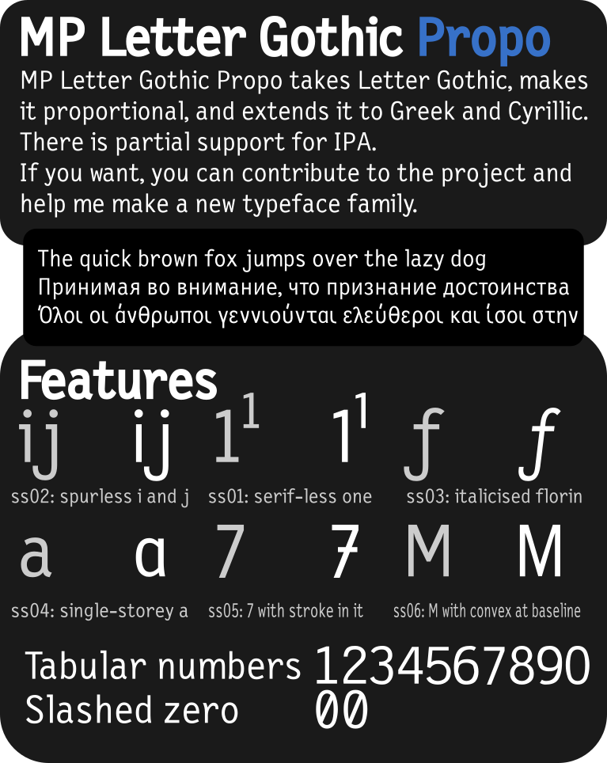
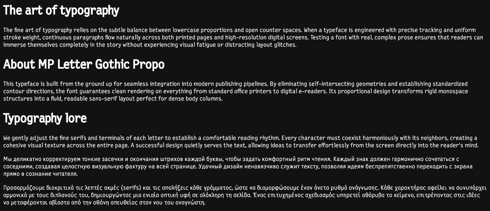
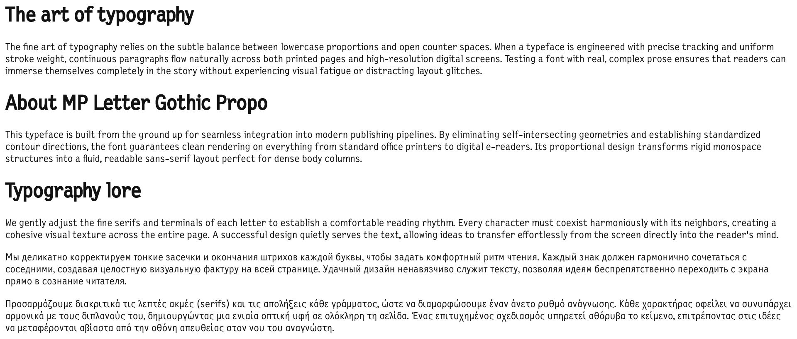

# MP Letter Gothic Propo
## It's a proportional version of Letter Gothic.
I took Letter Gothic and made it proportional. I also added some alts and tabular figures.

# FAQ
## Why does it even exist?
See, I love Letter Gothic because of its simplicity. I single-handedly think the reimaginations like Letter Gothic Recast look amazing as monospace. And I wanted a proportional version of the font to accompany it. And so I developed MP Letter Gothic Propo, all on FontForge.

## What's new with the font?
I added Cyrillic, Greek, true italics, stylistic alternates, tabular figures, slashed zero, subscripts, superscripts... everything you'd imagine! There's partial support for IPA and I'll develop full IPA later.

## How'd you make it proportional?
I used FontForge's Condense/Extend feature to fix the Mm Ww and the caps to make them wider.

## And what is it based on?
It's based on New Letter Gothic, a font made for ParaType.

## What does it have?
+ Cyrillic
+ Greek
+ True italics
+ Over 4 weights _(with italics)_
+ Stylistic alternates
+ Partial IPA

## Does it work in body text or headings?
Both! I made it with the idea in mind people would use this for UI/UX, but I'm sure there's an e-pub out there looking for a font like this.

**Dark mode:**

**Light mode:**

